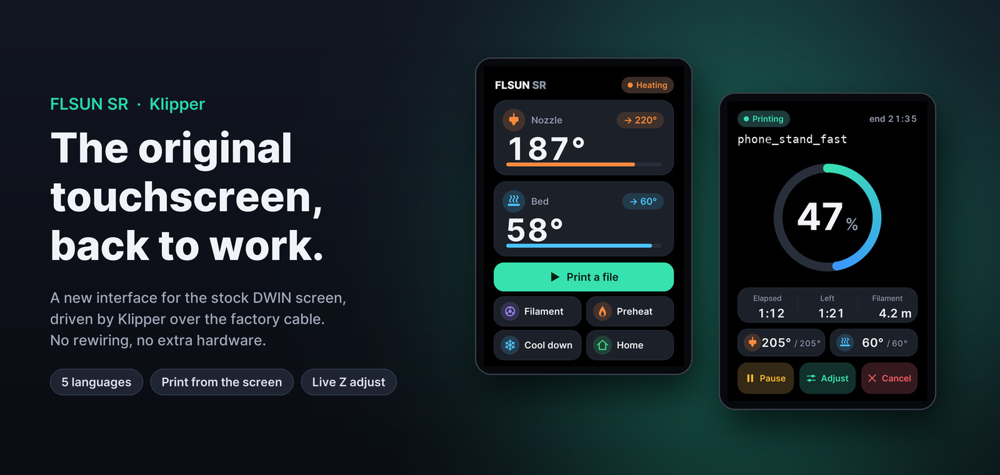
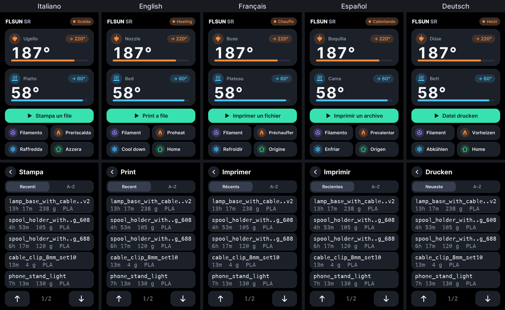
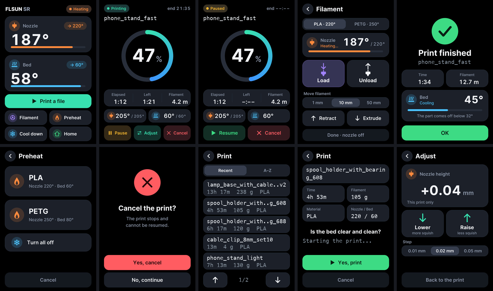

# FLSUN SR stock touchscreen on Klipper



When you move an **FLSUN SR** to Klipper, the stock touchscreen usually goes dark: Klipper doesn't speak to it, and
the common fixes mean rewiring it to the Raspberry Pi, adding a bridge board, or buying a new screen.

This project keeps the **original screen, on its original cable**, and gives it a new interface designed for
Klipper. You flash new graphics from a microSD card, drop one Python file into Klipper, and the screen works again.

## Highlights

- **Nothing to rewire, nothing to buy.** The screen stays on the mainboard cable it shipped with. The mainboard runs
  a stock Klipper build.
- **Start prints from the screen.** Browse your G-code files by most recent or A–Z, with print time, filament and
  material from Moonraker, check the details, confirm the bed is clear and print.
- **Everything you need at the printer.** Temperatures, preheat, filament load/unload, homing, cool down; progress,
  remaining time and end time; pause, resume and cancel.
- **Live first-layer tuning.** Raise or lower the nozzle by 0.01–0.05 mm while printing; the change is undone when
  the print ends.
- **Five languages.** English, Italian, French, Spanish and German, each a ready-to-flash folder.
- **Works alongside Mainsail and Fluidd.** Prints started from the web show up on the screen, and the other way round.
- **Tested without hardware.** A fake Klipper, a fake Moonraker and a fake screen run 75 checks in every language.



## Why this approach

| | This project | Screen moved to the Pi's UART | KlipperScreen |
|---|---|---|---|
| Original screen | ✅ | ✅ | ❌ new display needed |
| Original cable | ✅ | ❌ rewiring | ❌ |
| Extra hardware | none | wires / adapter | a display for the Pi |
| Mainboard firmware | stock Klipper | stock Klipper | stock Klipper |

The trick is that Klipper's MCU firmware already contains a small software serial port, used to talk to TMC stepper
drivers. This module borrows it to talk to the screen on the pins it is already wired to. [How it works](#how-it-works)
explains the details.

## Quick start

1. **Save your original screen files** (FLSUN's `DWIN_SET` folder), so you can always go back.
2. **Flash the graphics:** copy `lingue/<language>/DWIN_SET` to a FAT32 microSD, put it in the screen's slot and
   power on ([details](#3-flash-the-new-graphics)).
3. **Install the module:** copy `schermo_flsun.py` and `lingue/<language>/mappa.json` into `klippy/extras/`
   ([details](#4-install-the-klipper-module)).
4. **Add `[schermo_flsun]`** to `printer.cfg` and restart Klipper ([details](#5-configure)).



## Support the project

This is a free, open-source hobby project. If it brought your screen back to life and you'd like to say thanks,
you can send a small donation with PayPal:

<p>
  <a href="https://www.paypal.me/michitors"></a>
</p>
<p>
  <br>
  <sub>Or scan the code with your phone.</sub>
</p>

Bug reports, photos of your screen and pull requests (new languages especially) are just as welcome.

> **Status.** Working on one FLSUN SR (STM32F407 mainboard, Klipper v0.13, stock DWIN T5L screen) since
> October 2026. It has not been tested on other printers or screen revisions. Use at your own risk, and keep a copy
> of your original screen files.

---

## How it works

### 1. The serial link: Klipper's TMC UART, reused

On the SR the screen is wired to the mainboard's **USART3**:

- **PB10** is TX to the screen;
- **PB11** is RX from the screen;
- the link runs at 115200 baud, 8N1.

Under Marlin, the firmware drove that port. Klipper's MCU firmware has no command to use a spare UART for arbitrary
data. That is why most people move the screen to the Pi's GPIO UART, or give up on it.

Klipper's MCU firmware *does* contain a bit-banged serial port, though: `tmcuart`, the one used to configure
TMC2208/2209 drivers. It takes separate RX/TX pins and a configurable bit time. This module creates its own
`tmcuart` instance on PB10/PB11 at 115200 baud. It then sends raw **DGUS frames** with `tmcuart_send`, encoding
every byte with its start and stop bits on the host side. The mainboard firmware stays a **stock Klipper build**:
`tmcuart` is compiled in by default (`WANT_TMCUART`).

That channel has two limits, and the whole design follows from them:

- **At most 8 bytes per send.** A DGUS "write one word" frame is exactly 8 bytes. Longer frames, such as text, go
  out as consecutive 8-byte pieces, and the T5L accepts them.
- **Only the first data byte of a reply is reliable.** So every touch area on the screen writes **`code << 8`**
  into one variable (VP `0x5000`), and Klipper polls it:
  - every 0.3 s, or every 0.6 s while printing, and every 0.1 s for 2 s after a touch, so quick repeated taps
    (list ▲/▼, Lower/Raise, Retract/Extrude) are all counted;
  - a code is accepted after two identical reads, then cleared; the clear is read back and repeated if it was lost
    on the bit-banged line, so one touch is never counted twice;
  - it never needs more than that one byte back.

The module takes the same lock as the TMC drivers. If your stepper drivers also use `tmcuart`, the two never talk
at the same time.

### 2. The screen side: a new DGUS project, not new screen firmware

The T5L operating system, `T5LCFG.CFG`, `22_Config.bin` and the FLSUN fonts are **not touched**. Only the
"project" files the screen loads from microSD are replaced. They are all produced by `genera.py`, which uses Pillow
and needs no DWIN tools:

| File | Content |
|---|---|
| `32.icl` | Page backgrounds. Image *n* is page *n*; image 20+*n* is the same page with its buttons pressed. |
| `35.icl`, `41.icl`, `43.icl`, `50.icl` | Icon libraries for everything that changes: digit cells, progress ring, bars, status pills, list cards. They are cut out of the same backgrounds, so they blend in. |
| `13TouchFile.bin` | Touch areas. Each button writes its code into VP `0x5000` and, where needed, switches the page itself. |
| `14ShowFile.bin` | What each page shows: icon variables and ASCII text variables. |
| `mappa.json` | VP addresses, page numbers, fields, button codes and the module's messages in that language, read by the Klipper module. |

Things worth knowing about the format:

- **ICL checksum.** Bytes 6–7 of every `.icl` hold a **CRC-16/MODBUS** (little-endian) of bytes 8 to the end. With
  a wrong CRC the screen still finishes the update and prints «END», but silently keeps the old images.
- **Flash blocks.** The file `n.icl` is written starting at flash block *n* (256 KB per block). Old `.icl` files
  left on the card get loaded too and can overwrite the new blocks.
- **Memory budget.** About 8 MB is free for icons. Numbers are therefore built from per-digit cells, with every
  digit as wide as the widest one so they don't jiggle, instead of one image per value.
- **Text.** Dynamic text (file names, messages) uses the screen's internal 22×22 ASCII font. Accents are stripped
  (`ü` becomes `ue`, `é` becomes `e`) and long names are shortened.

### 3. The Klipper side: the screen is "dumb", the module is the brain

- **Page tracking.** The T5L never reports which page it is showing, so the module keeps track. Every button code
  also tells which page the screen moved to. The page is re-sent periodically. If the screen reboots, a marker
  variable goes back to 0 and the module redraws everything.
- **Writes.** Only values that changed are written.
- **Actions.** Button actions run as G-code from a reactor callback, one at a time, so button polling never stops.
- **Print status.** It comes from `print_stats` and `virtual_sdcard`, so prints started from Mainsail, Fluidd or the
  screen itself all show up.
- **File list.** The files come from `virtual_sdcard` (subfolders included). Print time, filament, material and
  temperatures come from Moonraker's metadata (`/server/files/metadata`), read in a background thread. Without
  Moonraker the list still works, with names only.

---

## Features

| Page | What it does |
|---|---|
| Home | Nozzle and bed temperature with targets. Buttons: Print a file, Filament, Preheat, Cool down (`TURN_OFF_HEATERS`), Home (`G28`). |
| Preheat | PLA 220/60 or PETG 250/80. The page closes by itself after 60 s. |
| Filament | Choose PLA or PETG. Load: 350 mm at 10 mm/s, then 50 mm slowly until it comes out. Unload: 10 mm forward, then 300 mm back. Move 1, 10 or 50 mm. «Done» turns the nozzle off. |
| Printing | Progress ring, elapsed and remaining time, filament used, estimated end time, temperatures. Shows «Heating» until the first layer starts. Buttons: Pause, Adjust, Cancel. |
| Paused | Resume or Cancel (`PAUSE` / `RESUME` / `CANCEL_PRINT`). |
| Cancel? | Confirmation page. Goes back by itself after 30 s. |
| Finished | Print time and filament used, then the bed temperature down to the point where the part comes off (32 °C). |
| Print a file | File list sorted by **Recent** (newest first) or **A–Z**, 5 per page, with time, grams (or metres) and material. Similar names are cut so they stay distinct. |
| Start confirmation | Full name, time, filament, material, nozzle/bed temperature. Asks «Is the bed clear and clean?», then «Yes, print» runs `SDCARD_PRINT_FILE`, as Moonraker does. If Klipper refuses, its error is shown in red. |
| Adjust | Live nozzle height during a print. Steps of 0.01, 0.02 or 0.05 mm, limited to ±0.30 mm. Uses `SET_GCODE_OFFSET Z_ADJUST=… MOVE=1`. The adjustment is undone when the print ends, so it applies to that print only. |

Every step of the test bench, in English: [docs/test_bench_en.png](docs/test_bench_en.png).

---

## Requirements

- An **FLSUN SR** with its stock DWIN T5L screen, still connected to the mainboard as from the factory.
- **Klipper** on the mainboard, built normally. The bit-banged UART is in every default build. Only if you turned
  off *"Support Trinamic stepper motor driver UART communication"* under the low-level options would you need to
  rebuild.
- `[virtual_sdcard]` in `printer.cfg` (Mainsail and Fluidd setups already have it), for the file list.
- `PAUSE`, `RESUME` and `CANCEL_PRINT` macros. `mainsail.cfg` and `fluidd.cfg` provide them.
- **Moonraker** (optional): print time, filament and temperatures in the file list.
- A **microSD card of 32 GB or less**, formatted **FAT32 with 4 KB clusters**.
- Python 3 and Pillow, **only** to regenerate the graphics or run the test bench.

---

## Installation

### 1. Keep your original screen files

This repository does **not** include FLSUN's files. Before flashing, save the `DWIN_SET` folder that matches your
screen: it comes with FLSUN's firmware package for the SR, or may still be on your old card. Flashing that folder
again restores the stock screen.

### 2. Pick your language

The ready-made graphics are in `lingue/<language>/`: `en` English, `it` Italian, `fr` French, `es` Spanish,
`de` German. Each folder holds a `DWIN_SET` for the screen and the `mappa.json` that goes with it. Use **both from
the same folder**.

### 3. Flash the new graphics

1. Format the microSD as FAT32 with 4 KB clusters. **Check the device name first: formatting erases the card.**
   - **Windows:** Format → FAT32, allocation unit size 4096 bytes.
   - **macOS:** `diskutil unmountDisk /dev/diskN`, then `sudo newfs_msdos -F 32 -c 8 /dev/rdiskNs1` (8 sectors
     per cluster).
   - **Linux:** `sudo mkfs.vfat -F 32 -s 8 /dev/sdX1`.
2. Copy `lingue/<language>/DWIN_SET` to the root of the card. It must hold **only these 7 files**:
   `13TouchFile.bin`, `14ShowFile.bin`, `32.icl`, `35.icl`, `41.icl`, `43.icl`, `50.icl`. Delete any other `.icl`
   or `.bin` files from that folder. On macOS, also remove the hidden `._*` files.
3. Turn the printer off, open the back of the screen and insert the card into the screen's own slot.
4. Turn the printer on. The screen turns blue and lists what it found. It must show **`.BIN Files: 002`** and
   **`.ICL Files: 005`**. Wait for **`END`**.
5. Turn the printer off, remove the card and turn it back on.

If every counter reads `000`, the screen could not read the card. Usually this means the wrong file system or
cluster size.

### 4. Install the Klipper module

On the Klipper host (replace `en` with your language):

```bash
cp schermo_flsun.py ~/klipper/klippy/extras/
cp lingue/en/mappa.json ~/klipper/klippy/extras/schermo_flsun_mappa.json
# keep Klipper's git tree clean for updates
echo "klippy/extras/schermo_flsun*" >> ~/klipper/.git/info/exclude
```

The module, `mappa.json` and the `DWIN_SET` **must come from the same version and the same language**. Page numbers,
VP addresses and button codes change between versions.

### 5. Configure

Add to `printer.cfg`:

```ini
[schermo_flsun]
tx_pin: PB10        # mainboard -> screen
rx_pin: PB11        # screen -> mainboard (use ^PB11 for the internal pull-up)
baud: 115200
```

Optional settings:

| Option | Default | Meaning |
|---|---|---|
| `moonraker` | `http://127.0.0.1:7125` | Moonraker's address, for the file details. Leave it empty to show names only. |
| `intervallo` | `1.0` | Seconds between updates of the values on screen. |
| `tasti_ogni` | `0.3` | Seconds between button reads. |
| `tasti_in_stampa` | `0.6` | Seconds between button reads while printing. |

Restart Klipper with no print running: `sudo systemctl restart klipper`.

**Note:** if your mainboard stays powered over USB from the host, Klipper does not notice when the printer itself
is switched off and on. After a power cycle, send `FIRMWARE_RESTART`.

---

## G-code commands

| Command | Use |
|---|---|
| `SCHERMO_STATO` | Print what the module believes: page, material, current action, print. |
| `SCHERMO_TASTO CODICE=n` | Act as if button *n* was pressed. Useful for testing without touching the screen. |
| `SCHERMO_PAGINA PAGINA=n` | Show page *n*. |
| `SCHERMO_MANDA TESTO="\x5a\xa5…"` | Send raw bytes to the screen. |
| `SCHERMO_CHIEDI TESTO="…"` | Send up to 8 bytes and print the reply. |

Always put quotes around the `TESTO` value: Klipper's command parser eats unquoted backslashes.

---

## Customizing

- **Labels, layout and pages** are in `genera.py`. Colours, icons and the drawing helpers are in `grafica.py`. They
  use the Inter font from `caratteri/`.
- **Translations** are in `testi.py`: the screen labels (`TRADUZIONI`), the messages the module writes in the
  screen's ASCII font (`MESSAGGI`), and the decimal separator (`DECIMALE`). To add a language, add it to all three
  and to `LINGUE`.
- **Material temperatures and filament lengths** are constants at the top of `schermo_flsun.py`.
- **Regenerate** with `python3 genera.py` (all languages, about a minute) or `python3 genera.py --lingua en`. It
  rebuilds `lingue/<language>/` and writes `verifica/<language>/`, which holds every page rebuilt *from the generated
  files* with sample values: check it before flashing. It prints a warning when a label does not fit its button, and
  stops if a module message does not fit its line. The last line of its output shows the last flash block used
  (now 50).
- **Test without hardware** with `python3 prova_modulo.py [--lingua en]`. It runs a fake Klipper (with
  `virtual_sdcard` and real files in a temporary folder), a fake Moonraker and a fake screen that reads the generated
  files and acts on touches as `13TouchFile.bin` says. It runs 75 checks and draws every step into `verifica/`.

The code (comments and names) is written in Italian.

---

## Limitations

- **Buttons react within 0.3–0.6 s**, because they are polled.
- **Dynamic text is ASCII only, in a 22×22 font.** Long file names are shortened in the list; the full name is on
  the confirmation page.
- **Only PLA and PETG presets** on the Preheat and Filament pages (change them in `schermo_flsun.py` and
  `genera.py`).
- **Tested on one printer only.** Other boards or screens need the screen wired to pins that `tmcuart` can drive.

---

## Credits

- [Klipper](https://github.com/Klipper3d/klipper): the `tmcuart` firmware code and `tmc_uart.py` helper this
  module builds on.
- [Inter](https://github.com/rsms/inter) by Rasmus Andersson, the typeface of the new graphics
  (SIL Open Font License 1.1, see `caratteri/LICENSE.txt`).
- The DGUS file formats were worked out from FLSUN's stock v1.3 screen files, which are not redistributed here.
- Another approach to the same problem: [yantz74/SR_Screen_Klipper](https://github.com/yantz74/SR_Screen_Klipper)
  moves the screen to the Raspberry Pi's UART.

Not affiliated with FLSUN or DWIN.

## License

GPL-3.0, the same as Klipper: the module runs inside Klipper and uses its `tmc_uart`. See `LICENSE`.
The fonts in `caratteri/` are under the SIL Open Font License 1.1.
